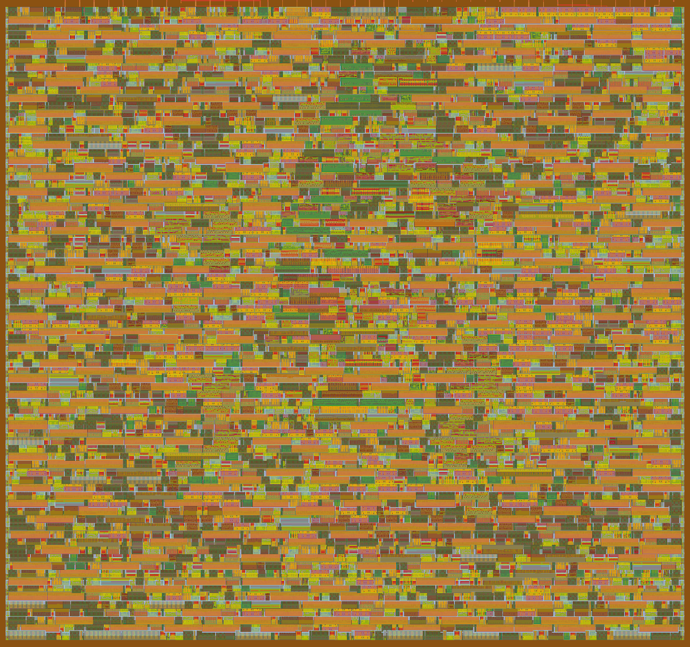
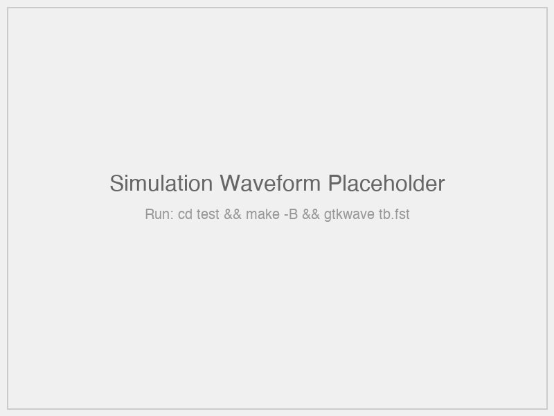
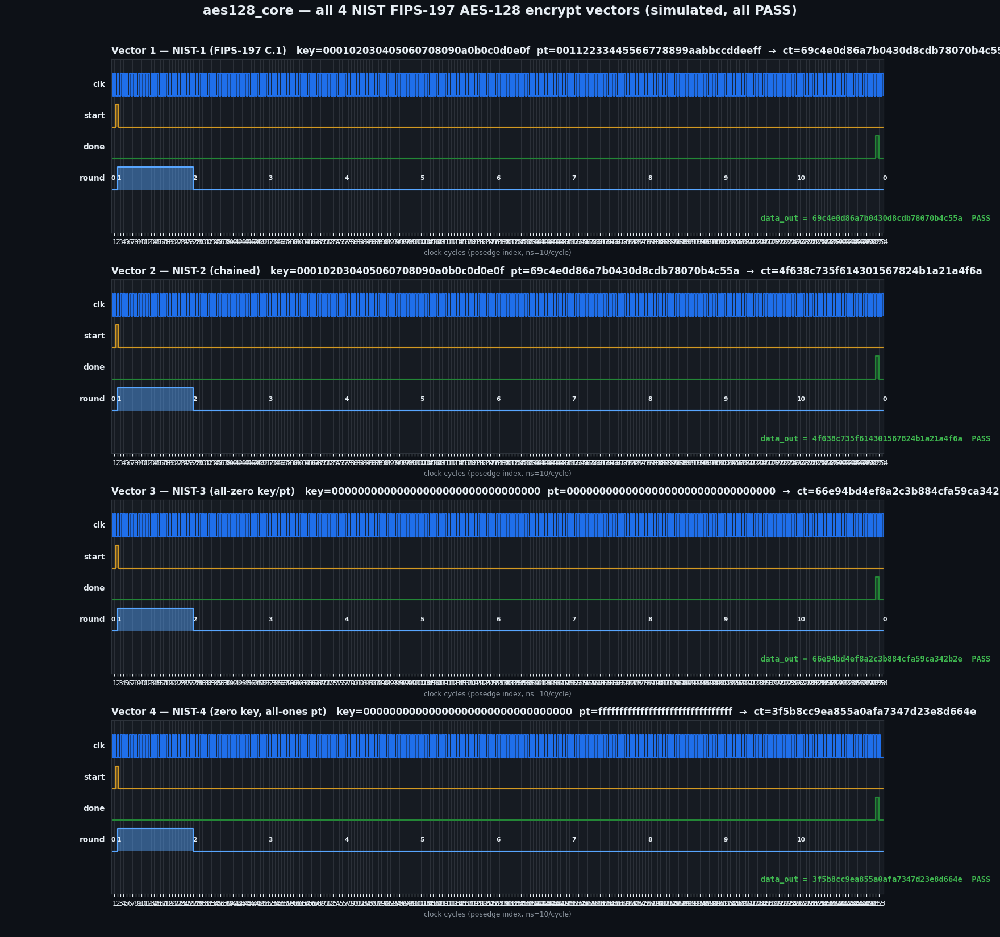
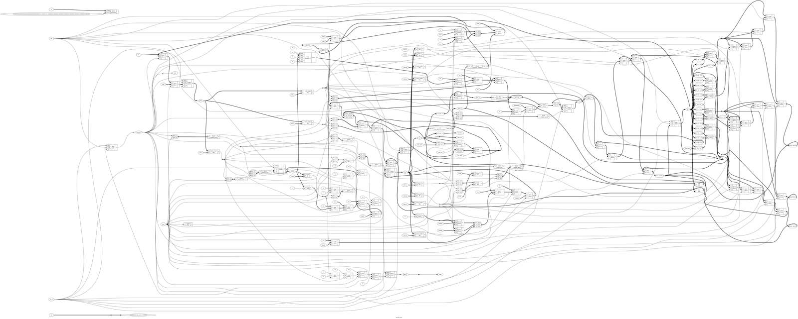

[](/haydenCoder/aes128-asic/workflows/gds/badge.svg) [](/haydenCoder/aes128-asic/workflows/docs/badge.svg) [](/haydenCoder/aes128-asic/workflows/test/badge.svg) [](/haydenCoder/aes128-asic/workflows/fpga/badge.svg)

# AES-128 Core for Tiny Tapeout GF180

This is my custom AES-128 ASIC, a byte-serial encryption core that fits in a 1×2 Tiny Tapeout tile on GF180MCU (180nm). I built it to learn how to take a chip from RTL all the way to silicon. The first version was a fully parallel encrypt/decrypt core. It was correct on all NIST vectors in simulation, but at ~712,000 µm² it could never fit a tile (the GDS CI placement error proved it: 1559% utilization). So I rewrote it as a byte-serial core with one shared S-box: ~297 clock cycles per encryption, ~3.3K generic cells, comfortably inside a 1×2 tile.

**View the GDS visualizer here** (generated after Tiny Tapeout workflow runs): https://gds-viewer.tinytapeout.com/?pdk=gf180mcu&model=https%3A%2F%2FhaydenCoder.github.io%2Faes128-asic%2F%2Ftinytapeout.oas


*Figure 1: Rendered GDS layout from the CI GDS workflow (`gds.yaml`, run on commit 636a855). Also viewable interactively in the [GDS visualizer](https://gds-viewer.tinytapeout.com/?pdk=gf180mcu&model=https%3A%2F%2FhaydenCoder.github.io%2Faes128-asic%2F%2Ftinytapeout.oas).*


*Figure 2: Simulated timing diagram of NIST test vector 1 encryption (iverilog VCD rendered with matplotlib). Key/data byte loads, START pulse, rounds 1–10, DONE with the ciphertext.*

## Features

- AES-128 encryption: 128-bit block, 128-bit key, 10 rounds (FIPS-197 compliant)
- Byte-serial, area-optimized core: one shared compact (Canright composite-field) S-box time-multiplexed over state and key bytes. SubBytes done by 128-bit rotation. In-place round-key updates through a 32-bit g register (~306 flops, ~3.3K generic cells)
- ~297 cycles per encryption (1 + 9×(8 key + 1 ShiftRows + 16 SubBytes + 4 MixColumns + 1 AddRoundKey) + 26)
- Serial I/O protocol: 8-bit `ui_in` for byte streaming, 8-bit `uo_out` for output
- 1×2 tile on GF180MCU (~340×320 µm core area; placed utilization well under the 60% density cap)
- 20 MHz target: static timing on GF180MCU verified by the CI GDS workflow (`gds.yaml`)
- Decryption was fully implemented and verified (openssl round-trip, 4/4 NIST vectors) in the earlier parallel-core version in RTL simulation; the taped-out hardware is encrypt-only to fit the tile budget

## How It Works

The core follows FIPS-197 encryption, serialized one byte at a time:

1. Load key: 16 key bytes stream into the round-key register (MSB first). During processing this register is updated in place, so it always holds the current round key.
2. Load data: 16 plaintext bytes stream into the 128-bit state register (MSB first).
3. START: state ^= round key (round 0 AddRoundKey), then 10 rounds:
   - Key update (8 cycles): `g = SubWord(RotWord(w3)) ^ Rcon` assembled 1 byte/cycle through the shared S-box, then the 4 key words are updated in place (`w[j] ^= w[j-1]` chain)
   - SubBytes (16 cycles): one byte per cycle through the shared S-box. The state register rotates left 8 bits per cycle, so after 16 rotations the byte order is restored.
   - ShiftRows + MixColumns + AddRoundKey (1 cycle): combinational. Final round skips MixColumns.
4. DONE: the ciphertext is in the state register and streams out 16 bytes on `uo_out`, MSB first

Serial protocol:
1. Pulse `START` (`uio_in[0]`) high for one clock
2. Stream 16 key bytes on `ui_in`, one per clock, MSB first
3. Stream 16 plaintext bytes on `ui_in`, one per clock, MSB first
4. Wait while `BUSY` (`uio_out[6]`) is high (~300 cycles)
5. Read 16 ciphertext bytes on `uo_out` with `DATA_VALID` (`uio_out[7]`) high, one per clock, MSB first

(`uio_in[7:1]` are unused.)

## Pinout

| Pin | Direction | Name | Description |
|-----|-----------|------|-------------|
| `ui_in[7:0]` | Input | `DATA_IN` | Serial byte input (key, then plaintext) |
| `uo_out[7:0]` | Output | `DATA_OUT` | Serial byte output (ciphertext) |
| `uio_in[0]` | Input | `START` | Pulse high to begin operation |
| `uio_in[7:1]` | — | Unused | Blank in info.yaml |
| `uio_out[6]` | Output | `BUSY` | High while processing |
| `uio_out[7]` | Output | `DATA_VALID` | High during output phase |

## Problems Overcome

| Problem | Solution |
|---------|----------|
| Parallel core was 712,000 µm² (13.7× over the 1×1 tile; GDS CI: utilization 1559.533%, GPL-0301) | Rewrote as byte-serial core with one shared S-box; moved to a 1×2 tile |
| LUT S-box (~2K mux cells) too big | Replaced with the compact Canright composite-field S-box (GF(2⁸) inversion in GF((2²)²) + affine transform, ~150 gates); verified 256/256 against the FIPS-197 table in Python and Verilog |
| 16-way byte-write muxes in the key schedule blew up area | Round key updated in place word-by-word through a 32-bit `g` register |
| Variable-index SubBytes part-select needed a 16:1 mux per state bit | SubBytes via 128-bit rotation (16 × 8-bit rotations = identity ordering) |
| Streaming wrapper sampled a stale byte on immediate LOAD_KEY→LOAD_DATA transition (wrong result `775a29b2…`) | Registered `key_loaded`/`data_loaded` flags replicate the original wrapper's one-cycle bubble |
| Inverse S-box table had 23 mis-transcribed entries (parallel core) | Regenerated the 256-entry inverse S-box programmatically from the forward S-box |
| Inverse round used the wrong operation order (parallel core) | Corrected to FIPS-197 InvCipher order: InvShiftRows → InvSubBytes → AddRoundKey → InvMixColumns |
| Decrypt FSM started with rk0 and skipped the final rk0 round (parallel core) | Decrypt started at AddRoundKey(rk10), rounds 9→1, ending with InvShiftRows/InvSubBytes/^rk0 |
| Test expected ciphertexts for vectors 2 and 4 were wrong | Corrected to openssl values `4f638c73…` and `3f5b8cc9…` |
| CI stub workflows referenced nonexistent `tt-gds-action@v1` and never installed cocotb | Real template workflows pinned to `TinyTapeout/tt-gds-action@ttgf26c` with `cocotb==2.1.0` |
| Stale token in git remote blocked push | Fixed credential helper via `gh auth setup-git` |
| Cocotb testbench drove concurrent clocks per test, causing contention | Single clock, one test running all 4 vectors sequentially |

## Test Bench

All 4 NIST FIPS-197 test vectors pass in encryption (verified against openssl):

| Test | Key | Plaintext | Ciphertext |
|------|-----|-----------|------------|
| NIST-1 (FIPS-197 C.1) | `000102030405060708090a0b0c0d0e0f` | `00112233445566778899aabbccddeeff` | `69c4e0d86a7b0430d8cdb78070b4c55a` |
| NIST-2 (chained) | same | `69c4e0d86a7b0430d8cdb78070b4c55a` | `4f638c735f614301567824b1a21a4f6a` |
| NIST-3 (all-zero) | `00...00` | `00...00` | `66e94bd4ef8a2c3b884cfa59ca342b2e` |
| NIST-4 (all-zero key, all-ones pt) | `00...00` | `ff...ff` | `3f5b8cc9ea855a0afa7347d23e8d664e` |

- `test/tb_core.v` (iverilog): drives the core directly through the byte-serial interface. 4/4 PASS
- `test/test.py` (cocotb): drives the full Tiny Tapeout wrapper through the pin protocol. 4/4 PASS
- Decrypt + encrypt→decrypt round-trip: 4/4 PASS in RTL simulation of the earlier parallel core (openssl-verified)


*Figure 3: All 4 NIST test vectors, simulated encryption (iverilog VCD rendered with matplotlib). All PASS.*


*Figure 4: Yosys `show` schematic of the byte-serial `aes128_core`. Shared S-box, rotation datapath, key-update logic.*

## Testing

```bash
bash scripts/check.sh   # lint + generic synthesis + cocotb (full pre-flight)
cd test && make         # cocotb simulation only
```

## Setup

Requires: `iverilog`, `verilator`, `yosys`, `cocotb` (e.g. via `oss-cad-suite` in PATH)

```bash
git clone https://github.com/haydenCoder/aes128-asic
cd aes128-asic
./scripts/check.sh     # lint → synth → cocotb
make -C test           # cocotb simulation
gtkwave test/sim_build/tb_core.fst   # view waveforms in GTKWave
```

## Screenshots & Visualizations

| Visualization | Description |
|---------------|-------------|
|  | Full tile layout, rendered by the CI GDS workflow (`gds.yaml`). Also in the [GDS visualizer](https://gds-viewer.tinytapeout.com/?pdk=gf180mcu&model=https%3A%2F%2FhaydenCoder.github.io%2Faes128-asic%2F%2Ftinytapeout.oas) |
|  | Timing diagram (VCD → PNG) of NIST vector 1 encryption |
|  | All 4 NIST test vectors, simulated encryption. All PASS |
|  | Yosys `show` schematic of `aes128_core` |

## Programming Configuration

The `fpga` workflow (`.github/workflows/fpga.yaml`, manual dispatch) builds an
ICE40UP5K bitstream using the Tiny Tapeout `tt-gds-action/fpga/ice40up5k` action.
For physical testing, the design targets the Tiny Tapeout dev board (RP2350 or
IcePi Zero): drive the serial protocol above from the board's controller and
check the ciphertext against the NIST vectors.

## Inspiration

This project uses the Tiny Tapeout template which has all of the workflows to build your project and get it ready for manufacturing. Thanks to the Tiny Tapeout community and Matt Venn for making silicon accessible!

## License

Apache-2.0 (compatible with Tiny Tapeout submission requirements).

## Author

Chung Hon Ting (Diocesan Boys' School, 8M #4)
